<div align="center">



<br><br>

<!-- Badges Header -->
<p align="center">
  <a href="https://github.com/RidhoPtraDev">
    
  </a>
  <a href="#-engineering-stack">
    
  </a>
  <a href="https://github.com/RidhoPtraDev?tab=repositories">
    
  </a>
</p>

</div>

<br>

<!-- Interactive Developer Terminal SVG -->
<div align="center">
  
</div>

<br>

<!-- Senior Engineering Metrics & KPIs -->
<div align="center">
  
</div>

<div align="center">
  
</div>

### 👨‍💻 Executive Summary

I am **Ridho Putra Aulia** (aku **Emonn**), a passionate **Full-Stack Software Engineer** dedicated to building resilient, scalable, and high-performance digital products. My engineering philosophy revolves around **clean code, domain-driven design, and robust system architecture** from pixel-perfect responsive user interfaces to event-driven backends and database optimization.

```bash
❯ ridho --status
[SYSTEM OK] Crafting production-grade software with modern enterprise patterns.
[FOCUS] TypeScript • Next.js App Router • NestJS Microservices • PostgreSQL • Docker
```

- 🔭 **Current Focus**: Architecting **MindCare** (mental healthcare ecosystem), **Parenting1stKey** (AI parenting & child growth platform), and **SmartVault** (cross-platform finance manager).
- ⚙️ **Core Values**: Scalability, strict type-safety, observability, and human-centric UI/UX.
- 💡 **Open for Collaboration**: High-impact products, enterprise engineering teams, and visionary startup initiatives.

<br>

<div align="center">
  
</div>

<table align="center" width="95%">
  <thead>
    <tr>
      <th width="28%">Domain</th>
      <th width="72%">Technologies & Enterprise Tooling</th>
    </tr>
  </thead>
  <tbody>
    <tr>
      <td><b>Languages</b></td>
      <td>
        
        
        
        
      </td>
    </tr>
    <tr>
      <td><b>Frontend Architecture</b></td>
      <td>
        
        
        
        
        
      </td>
    </tr>
    <tr>
      <td><b>Backend & APIs</b></td>
      <td>
        
        
        
        
      </td>
    </tr>
    <tr>
      <td><b>Databases & ORM</b></td>
      <td>
        
        
        
        
      </td>
    </tr>
    <tr>
      <td><b>DevOps & Infra</b></td>
      <td>
        
        
        
        
      </td>
    </tr>
  </tbody>
</table>

<br>

<div align="center">
  
</div>

### 🚀 Production & Flagship Applications

<table width="100%">
  <thead>
    <tr>
      <th width="30%">Project & Role</th>
      <th width="45%">Architecture & Key Features</th>
      <th width="25%">Engineering Stack</th>
    </tr>
  </thead>
  <tbody>
    <tr>
      <td align="center">
        <a href="https://github.com/RidhoPtraDev/MindCare">
          
        </a>
        <br>
        <b><a href="https://github.com/RidhoPtraDev/MindCare">MindCare</a></b><br>
        <sub>Lead Full-Stack Architect</sub>
      </td>
      <td>
        Comprehensive mental healthcare platform featuring an <b>AI-powered cognitive assistant</b>, secure real-time audio/video consultations with certified psychologists, and the interactive <b>Mood Journey tracker</b> with sentiment analytics.
      </td>
      <td>
        <code>Next.js 14</code> <code>NestJS</code><br>
        <code>PostgreSQL</code> <code>WebRTC</code><br>
        <code>TailwindCSS</code>
      </td>
    </tr>
    <tr>
      <td align="center">
        <a href="https://github.com/RidhoPtraDev/SmartVault">
          
        </a>
        <br>
        <b><a href="https://github.com/RidhoPtraDev/SmartVault">SmartVault</a></b><br>
        <sub>Full-Stack Engineer</sub>
      </td>
      <td>
        Cross-platform personal finance & asset manager (Android & iOS). Features smart transaction tagging, automated <b>AI OCR receipt scanning via WhatsApp</b>, and periodic scheduled financial health diagnostics.
      </td>
      <td>
        <code>React Native</code> <code>Expo</code><br>
        <code>TypeScript</code> <code>Node.js</code><br>
        <code>PostgreSQL</code>
      </td>
    </tr>
    <tr>
      <td align="center">
        <a href="https://github.com/RidhoPtraDev/Parenting1stkey">
          
        </a>
        <br>
        <b><a href="https://github.com/RidhoPtraDev/Parenting1stkey">Parenting1stKey</a></b><br>
        <sub>Lead Backend & AI Architect</sub>
      </td>
      <td>
        AI-powered modern parenting ecosystem featuring <b>ParentBot AI</b> (RAG-based child development assistant), expert consultations (chat & video call with certified psychologists/pediatricians), and <b>Good Gizi</b> toddler nutrition calculators.
      </td>
      <td>
        <code>Next.js 14</code> <code>NestJS</code><br>
        <code>PostgreSQL</code> <code>Redis</code><br>
        <code>pgvector</code> <code>TypeORM</code>
      </td>
    </tr>
    <tr>
      <td align="center">
        <a href="https://github.com/RidhoPtraDev/learning-space">
          
        </a>
        <br>
        <b><a href="https://github.com/RidhoPtraDev/learning-space">learning-space</a></b><br>
        <sub>Backend Engineer & Core Maintainer</sub>
      </td>
      <td>
        Engineering playground dedicated to researching modern web primitives, algorithm optimization, design system components, and clean code paradigms.
      </td>
      <td>
        <code>TypeScript</code> <code>DOM APIs</code><br>
        <code>State Management</code>
      </td>
    </tr>
  </tbody>
</table>

<br>

<div align="center">
  

  <br>

  

  <sub><i>Snapshot statis yang dioptimasi agar profil tetap super cepat dan 100% bebas error/downtime pihak ketiga.</i></sub>
</div>

<br>

<!-- Animated Contribution Grid -->
<div align="center">
  <p align="center"><b>Contribution Activity Stream</b></p>
  
</div>

<br>

<div align="center">
  

  <br>

  <p align="center">
    <a href="https://github.com/RidhoPtraDev">
      
    </a>
    <a href="https://linkedin.com/in/">
      
    </a>
    <a href="mailto:ridhoputradev@gmail.com">
      
    </a>
  </p>

  <br>

  

  <br><br>

  

</div>
